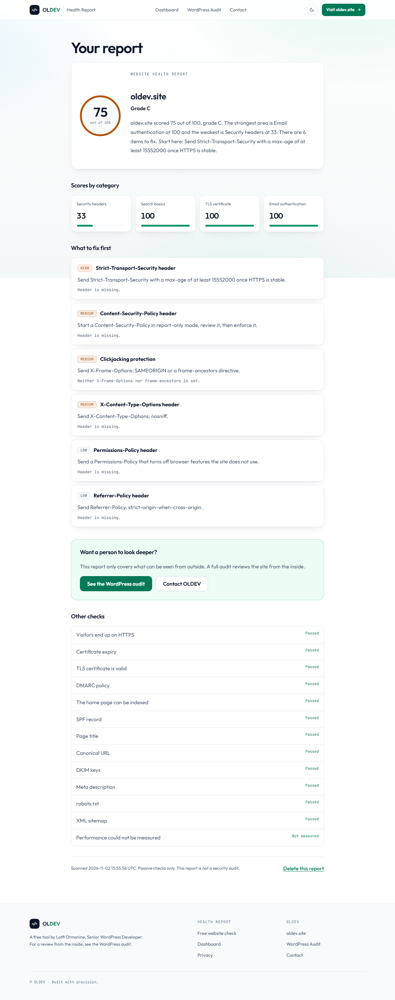
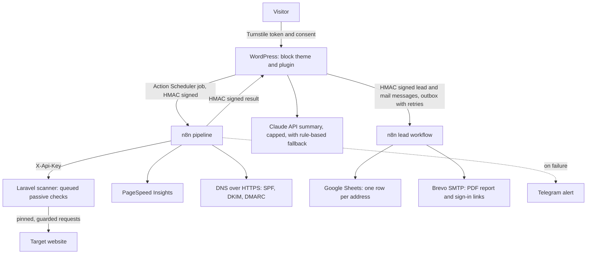
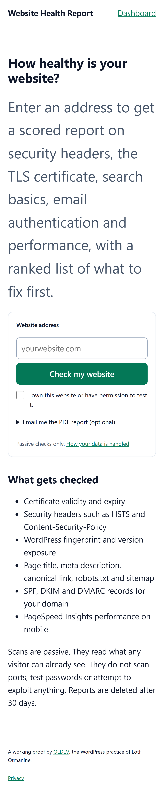
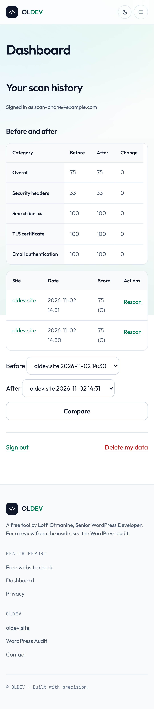
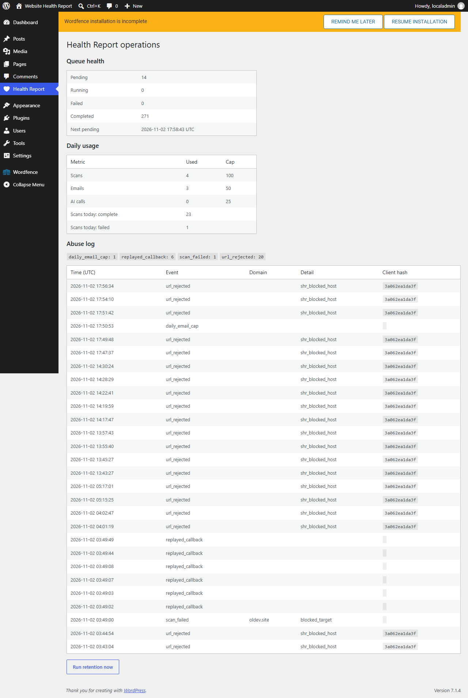

# Website Health Report

[](https://github.com/Lotmanine/wp-site-health-report/actions/workflows/ci.yml)

CI runs the WordPress PHPUnit suite on WordPress 7.1 and MariaDB, PHPCS and PHPStan for the plugin and the theme,
and the scanner's PHPUnit suite. The Playwright end-to-end tests run locally only.

A visitor enters a website address and gets a scored report on security headers, the TLS certificate,
search basics, email authentication and performance, with a ranked list of what to fix first.

It is a working proof of WordPress and integration engineering by [OLDEV](https://oldev.site): a block theme
and custom plugin, a Laravel service, an n8n pipeline and signed messages between them. Scans are passive.
They read public pages and DNS records, and they never scan ports, test credentials or exploit anything.



## Architecture



| Part | Path | Job |
|---|---|---|
| WordPress plugin | `wordpress/plugin/oldev-health-report` | Intake, limits, queue, scoring, reports, dashboard, admin screen |
| Block theme | `wordpress/theme/oldev-health` | Landing page and layout in the oldev.site design system, light and dark |
| Scanner | `scanner` | Laravel service for outbound requests to untrusted hosts |
| n8n workflows | `n8n` | Orchestration, retries, signed result, alert |
| End-to-end tests | `tests/e2e` | Playwright, desktop and phone |

Design, data model, message contracts and the threat model are in [PLAN.md](PLAN.md).

## What it does

- URL form with Turnstile verified on the server and a required ownership consent box.
- Report at an unguessable signed URL, with scores by category and a ranked fix list.
- Magic-link dashboard with scan history, rescans and before and after comparison.
- Optional PDF by email, and a lead row with score, failed checks and consents, both through a signed n8n
  webhook. Lead events wait in an outbox table until n8n confirms them, and only the row id goes through the queue.
- Optional AI summary. The prompt holds only check results this code generated, never text from the scanned page.
- Admin screen for queue health, the abuse log and daily usage.
- 30-day retention job, delete-this-report on every report and delete-my-data on the dashboard. Erasing an
  address also deletes its lead row.
- Wordfence firewall in extended protection, set up from code on every boot. Apache trusts X-Forwarded-For only
  from the networks the container is attached to, and no address bypasses the firewall.

## Safety

- **SSRF:** every A and AAAA record is resolved first, and one private or reserved address rejects the host.
  The connection is pinned to the checked address, redirects are followed by hand with every hop checked again,
  only ports 80 and 443 are allowed, and time and size limits apply.
- **Signed messages:** HMAC-SHA256 over raw bytes, constant-time comparison, a 300-second window and a nonce ledger.
  A finished scan can never be overwritten.
- **Caps:** per-IP limits, a per-domain cooldown, and global daily caps on scans, emails and AI calls. Emails
  stop at 50 per day whatever the configuration says.

## Screenshots

| Landing | Landing, dark | Report on phone | Dashboard on phone |
|---|---|---|---|
|  |  |  |  |



A real report for `oldev.site` is in [docs/sample-report](docs/sample-report).

The theme follows the oldev.site design system: the same colour tokens for light and dark, Outfit and
JetBrains Mono, buttons, cards, header and footer. It defaults to the visitor's system preference and
remembers the toggle. Both fonts are self-hosted as single latin variable files (OFL licences next to
them): the site's CSP allows fonts only from its own origin, and it saves a third-party connection.

## Run it locally

You need Docker, and Node for the end-to-end tests.

```sh
cp .env.example .env
# Fill in the secrets, then set these for local use:
#   WP_HOME=http://localhost:18081
#   SHR_N8N_WEBHOOK_URL=http://n8n:5678/webhook/shr-scan
#   SHR_CALLBACK_BASE=http://wordpress
#   SHR_SCANNER_URL=http://scanner:8080
#   SHR_TRUSTED_PROXY_HOPS=0
#   SHR_DOMAIN_COOLDOWN_MINUTES=0

docker compose -f docker-compose.yml -f docker-compose.local.yml --env-file .env up -d --build

python scripts/prepare-local-n8n.py
docker compose -f docker-compose.yml -f docker-compose.local.yml --env-file .env exec n8n n8n import:credentials --input=/local/credentials.json
docker compose -f docker-compose.yml -f docker-compose.local.yml --env-file .env exec n8n n8n import:workflow --input=/local/pipeline.json
docker compose -f docker-compose.yml -f docker-compose.local.yml --env-file .env exec n8n n8n publish:workflow --id=hrScanPipelineLocal
docker compose -f docker-compose.yml -f docker-compose.local.yml --env-file .env restart n8n
```

The site is at `http://localhost:18081`. With `SHR_N8N_LEADS_URL` empty, mail is written to `/tmp/shr-mail`
inside the WordPress container and lead events stay in the outbox table.

## Tests

```sh
# WordPress: PHPUnit on real WordPress and MariaDB, PHPCS, PHPStan
docker compose -f docker-compose.yml -f docker-compose.local.yml --env-file .env --profile test run --rm tools composer install
docker compose -f docker-compose.yml -f docker-compose.local.yml --env-file .env --profile test run --rm tools sh -c "vendor/bin/phpunit && vendor/bin/phpcs && vendor/bin/phpstan analyse --memory-limit=1G"

# Scanner
docker build -t shr-tools -f docker/tools/Dockerfile .
docker run --rm -v "$PWD/scanner:/app" shr-tools sh -c "composer install && vendor/bin/phpunit"

# End to end, with the local stack running
cd tests/e2e && npm install && npx playwright install chromium && npx playwright test
```

Deployment is covered in [DEPLOY.md](DEPLOY.md).

## Author

Built by **Lotfi Otmanine**, senior WordPress developer at [OLDEV](https://oldev.site).

- Website: [oldev.site](https://oldev.site)
- Hire me on Upwork: [upwork.com/freelancers/~01bd748fcb665b90ca](https://www.upwork.com/freelancers/~01bd748fcb665b90ca)
- LinkedIn: [linkedin.com/in/lotfi-otmanine](https://www.linkedin.com/in/lotfi-otmanine)
- GitHub: [github.com/Lotmanine](https://github.com/Lotmanine)
- Case study: [oldev.site/work/26-website-health-report](https://oldev.site/work/26-website-health-report/)

## License

GPL-2.0-or-later.
